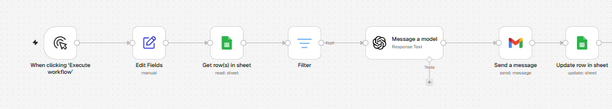

# Automação de comunicados com n8n e IA

Fluxo no n8n que lê uma lista de contatos numa planilha, personaliza cada mensagem com IA, envia por e-mail e registra na própria planilha quem já recebeu.

## O problema
Enviar comunicados a muitos contatos de forma manual é lento e repetitivo, e é fácil esquecer quem já recebeu ou reenviar para a mesma pessoa.

## A solução
Um fluxo de 7 blocos no n8n:

1. **Gatilho manual** inicia o fluxo.
2. **Google Sheets (ler linhas)** lê os contatos da planilha.
3. **Filter** deixa passar só quem está com `status` em branco, o que evita reenvios.
4. **OpenAI (GPT-5 mini)** reescreve a mensagem base de forma cordial e curta, chamando a pessoa pelo nome, sem inventar informações.
5. **Gmail (enviar mensagem)** envia o e-mail para cada contato.
6. **Google Sheets (atualizar linha)** marca `status = enviado` e grava a data e hora do envio.

O bloco **Edit Fields** é apenas um resquício do exercício inicial e não interfere no resultado.

## Estrutura da planilha
| nome | contato | assunto | mensagem_base | status | data_envio |
|---|---|---|---|---|---|

`status` e `data_envio` ficam em branco e são preenchidos pelo fluxo.

## Resultado
- Cada contato recebe uma mensagem personalizada, sem o envio manual um a um.
- A planilha mostra quem já recebeu e quando.
- Rodar o fluxo de novo não reenvia para quem já está marcado como enviado.
- Testado com contatos próprios, com envio e atualização da planilha funcionando de ponta a ponta.

## Como usar
1. Importe `automacao-comunicados.json` no n8n (menu do fluxo → **Import → From file**).
2. Crie a sua planilha com as colunas acima e selecione-a nos dois blocos do Google Sheets (o arquivo traz o texto `SEU_ID_DA_PLANILHA` no lugar do ID real).
3. Conecte as suas credenciais do Google (Sheets e Gmail) e de IA.
4. Preencha a planilha e execute o fluxo.

## Ferramentas
n8n, Google Sheets, Gmail, OpenAI (GPT-5 mini).

## Evolução prevista
Trocar o gatilho manual por um agendado e usar um canal oficial de mensagens (como a API do WhatsApp Business) no lugar do e-mail.

## Sobre
Evolução de uma automação anterior em Python que enviava mensagens em massa a partir de planilhas Excel.
